<div align="center">


# toasty

**SNS 소셜 셀러를 위한 계좌 결제 기반 라이브 커머스**

라이브 방송 중에 상품을 바로 사고, 방송이 끝나면 주문·배송 관리까지 이어지는 모바일 웹앱

`2026.08 – 2026.09` · `PM 1 · Designer 1 · Dev 2` · `Mobile Web App`

[Frontend 저장소](https://github.com/toasty-violet/toasty-FE) · [Backend 저장소](https://github.com/toasty-violet/toasty-BE)

</div>

> 운영 서버는 비용 문제로 내려 두었습니다. 서비스 화면은 아래 이미지로, 서버 구조와 구현은 코드와 이 문서로 확인할 수 있습니다.

<br />

## 목차

1. [기획 배경](#기획-배경)
2. [서비스 목표](#서비스-목표)
3. [주요 기능](#주요-기능)
4. [시스템 아키텍처](#시스템-아키텍처)
5. [기술 스택](#기술-스택)
6. [기술적 고민과 해결](#기술적-고민과-해결)
7. [팀](#팀)
8. [로컬에서 실행하기](#로컬에서-실행하기)

<br />

## 기획 배경

인스타그램 라이브로 옷을 파는 빈티지 셀러는 방송 한 번에 수백만 원을 팔지만, 주문은 **댓글과 DM**으로 받고 결제는 **계좌이체**로 받습니다.
셀러는 입금 확인과 배송지 취합을 손으로 하고, 구매자는 DM으로 주문하고 직접 송금해야 합니다.

소셜 셀러 20명과 구매자 46명을 설문·인터뷰한 결과는 다음과 같습니다.

- 판매자의 **85%가 계좌이체**로 결제를 받고, **75%가 DM으로 주문**을 받는다
- 판매자의 가장 큰 불편은 **주문·입금 확인 수작업**이다
- 구매자의 가장 큰 불편은 **결제창이 다른 사이트나 앱으로 넘어가는 것**이다

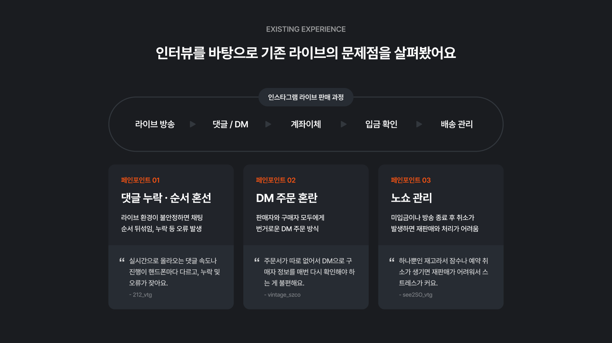

<details>
<summary><b>리서치 자료 더 보기</b> (시장 규모 · 설문 결과 · 타깃 · 경쟁 서비스 비교)</summary>
<br />

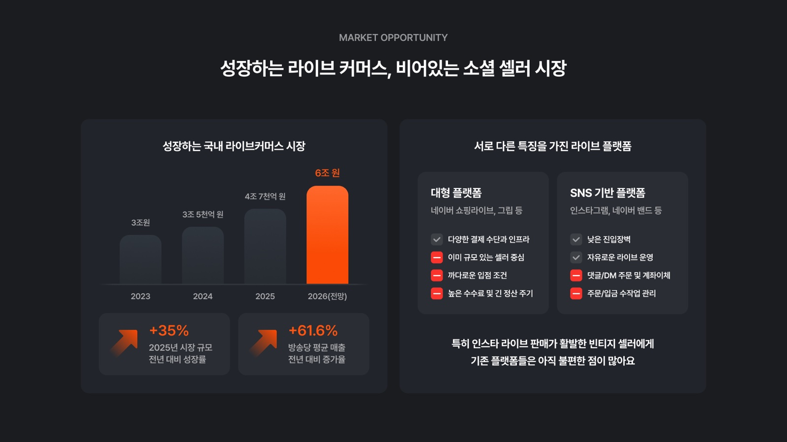
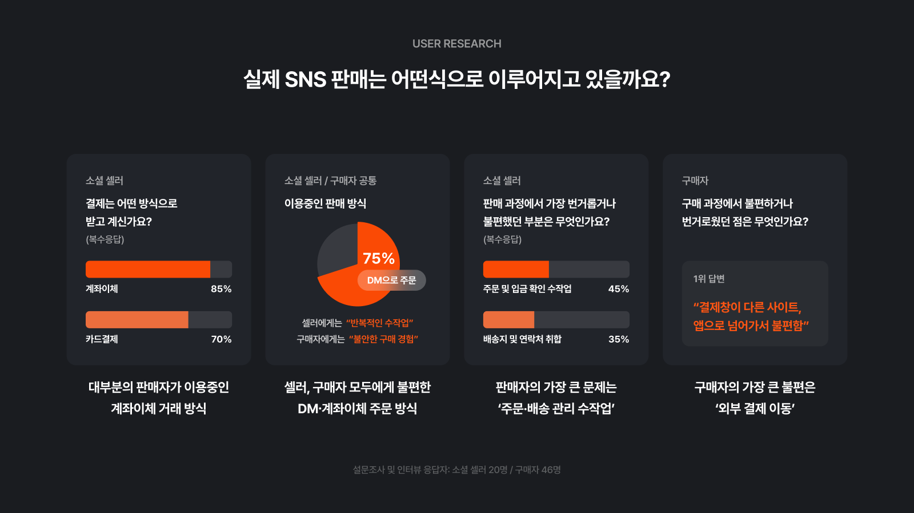
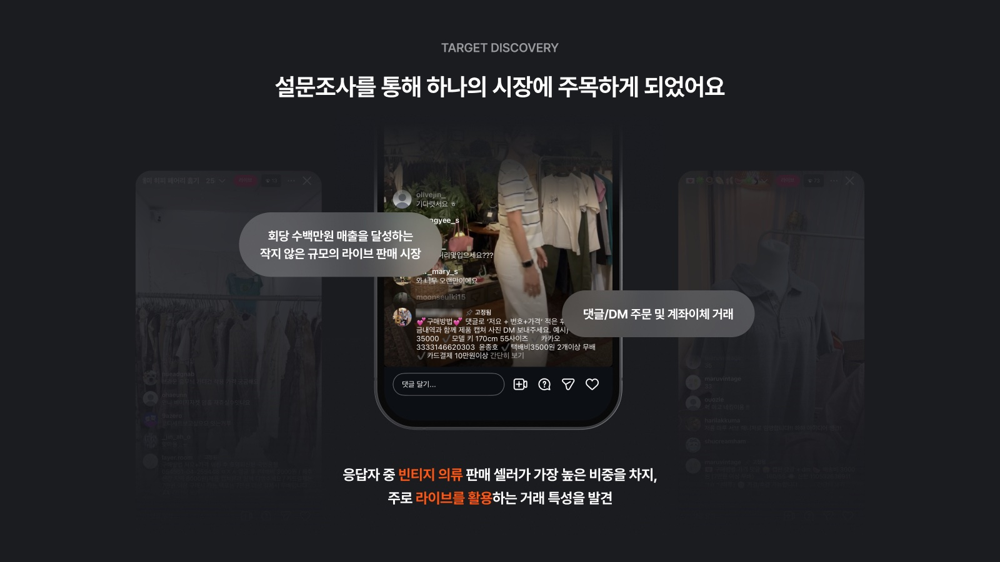
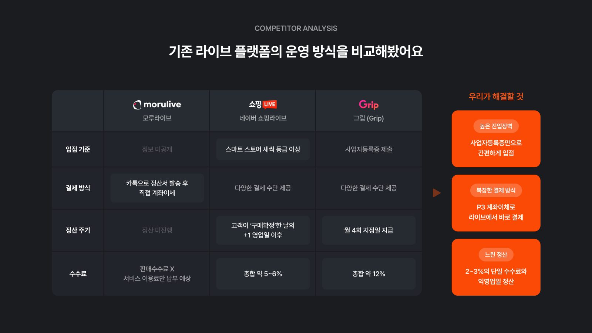

</details>

<br />

## 서비스 목표

**라이브의 편리함은 그대로 두고, 관리의 번거로움을 줄입니다.**
방송 전 준비부터 방송 후 배송까지를 하나의 흐름으로 연결했습니다.

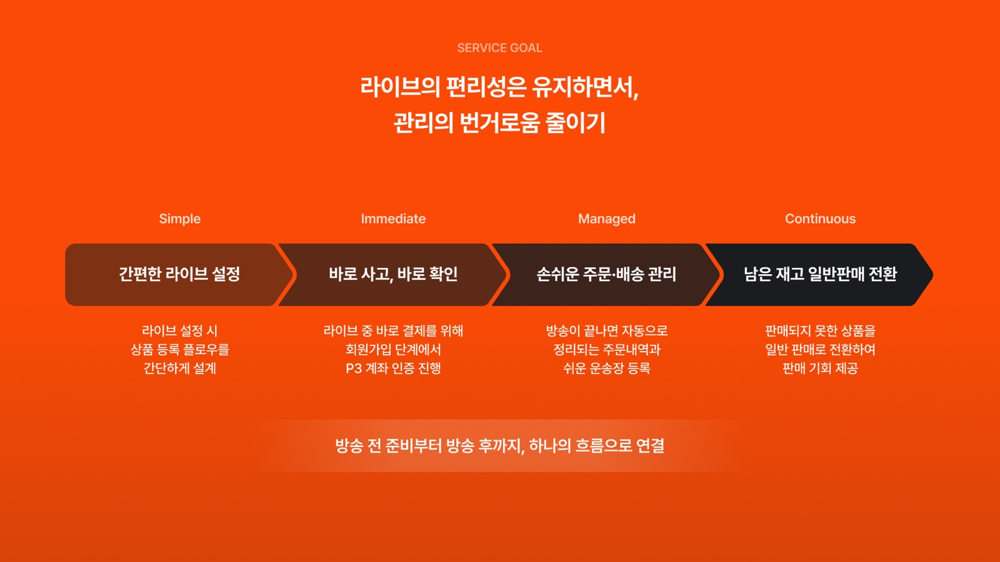

<br />

## 주요 기능

### 구매자: 라이브를 보면서 바로 구매

재고 수만큼만 결제창에 들어갈 수 있는 **선착순 구매**입니다. 구매 버튼을 누르면 재고를 5분간 잡아 두고, 그 안에 결제하지 않으면 다음 사람에게 넘어갑니다.
계좌는 회원가입 때 미리 등록해 두기 때문에, 라이브 화면을 벗어나지 않고 결제가 끝납니다.

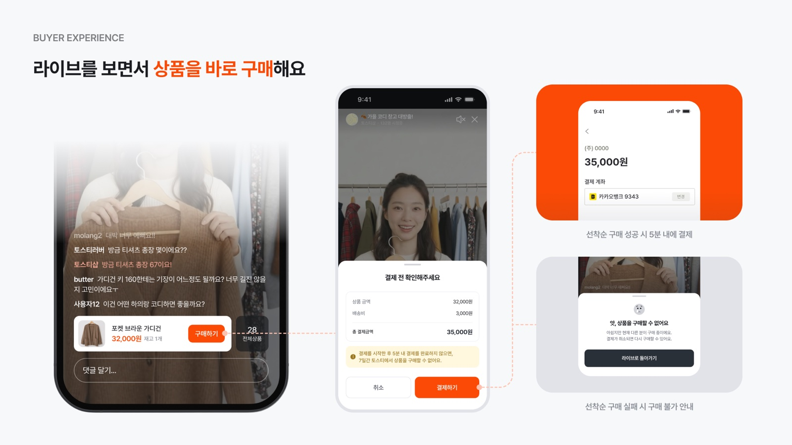

### 판매자: 방송 전, 상품과 라이브를 간편하게 준비

사진을 여러 장 고르면 **사진 수만큼 상품이 한 번에 생성**됩니다. 상품이 수십 개인 빈티지 라이브에 맞춘 등록 방식입니다.

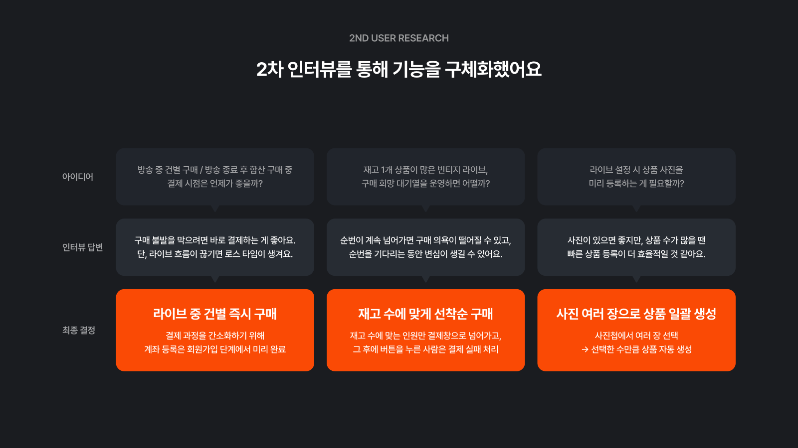

### 판매자: 방송 중에는 판매에 집중

다음 상품 고정, 판매 현황 확인, 가격·재고 수정을 방송 화면 안에서 처리합니다.

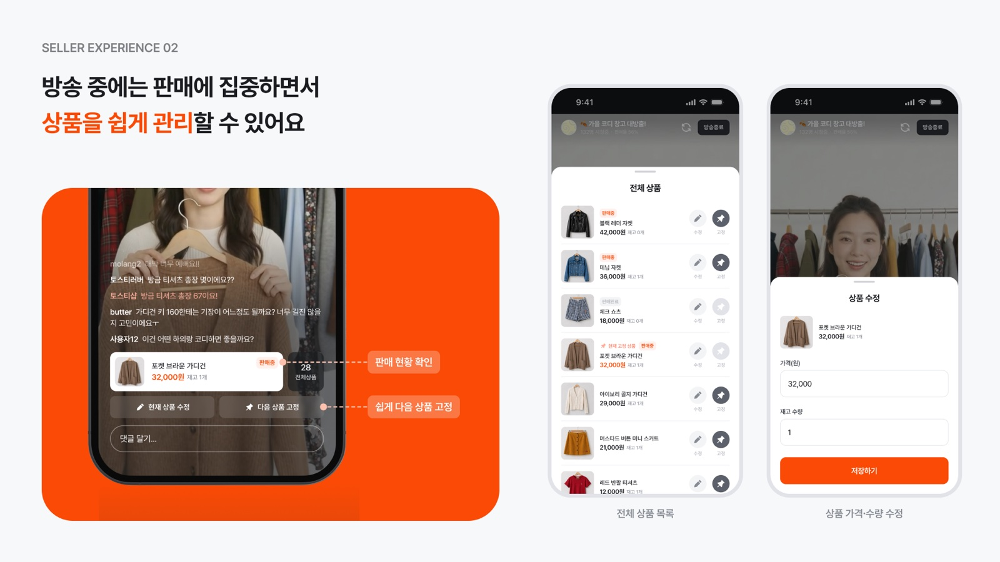

### 판매자: 방송 후 관리까지 자동으로

방송이 끝나면 주문이 주문탭에 정리되고, 팔리지 않은 상품은 일반 판매로 넘어가 스토어에서 계속 팔립니다.
운송장 번호를 등록하면 구매자에게 배송 시작 문자가 자동으로 발송됩니다.

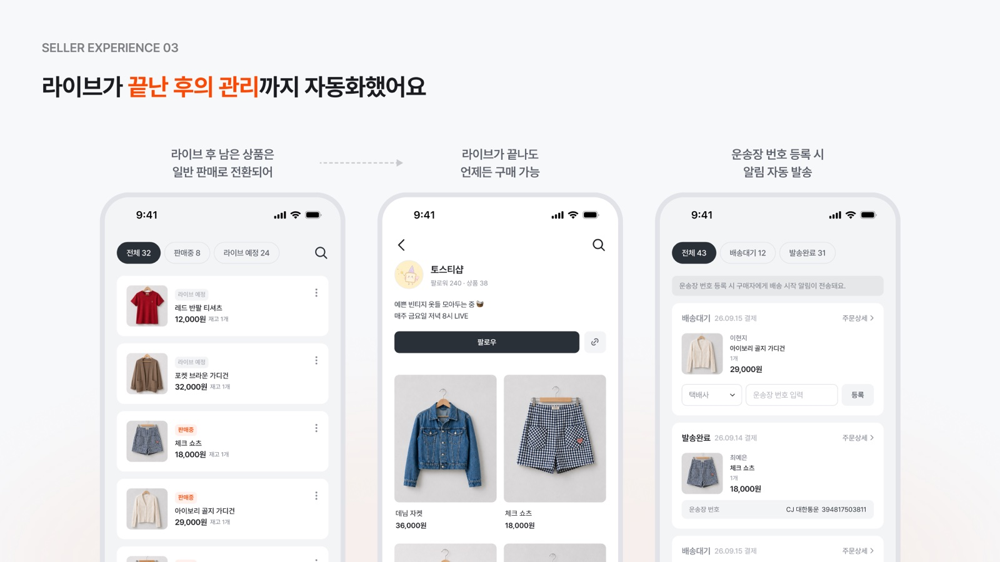

<details>
<summary><b>전체 화면 흐름 보기</b> (로그인·온보딩 · 구매자 · 판매자)</summary>
<br />

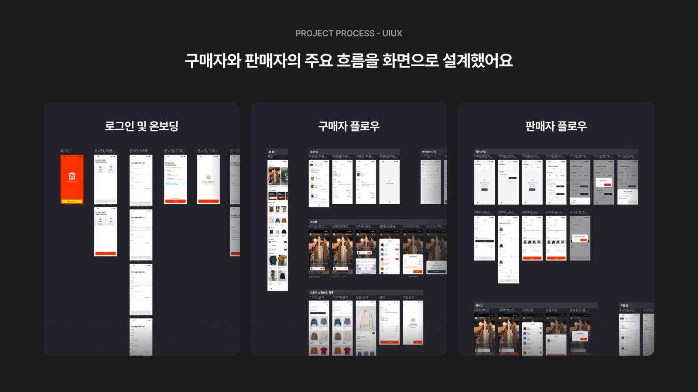

</details>

<br />

## 시스템 아키텍처

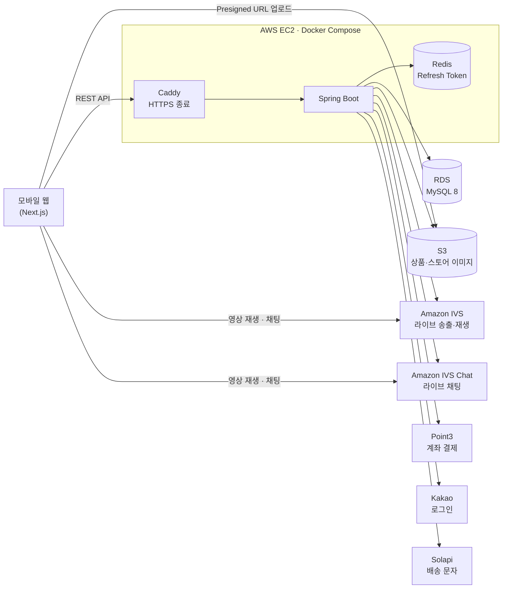

- **배포**: `main`에 머지되면 GitHub Actions가 코드를 서버로 `rsync`하고 Docker Compose로 다시 띄웁니다. 서버에는 저장소 자격증명을 두지 않습니다.
- **CI**: PR마다 MySQL·Redis 서비스 컨테이너를 띄워 `./gradlew build`(Spotless 포맷 검사 포함)를 돌립니다.
- **스키마**: Flyway 마이그레이션으로만 바꾸고, JPA는 `ddl-auto: validate`로 엔티티와 스키마가 어긋나면 기동을 막습니다.

<br />

## 기술 스택

| 구분 | 사용 기술 |
| --- | --- |
| Language / Build | Java 21, Gradle (Kotlin DSL) |
| Framework | Spring Boot 3.5 (Web MVC, Validation, Security, Actuator) |
| Data | Spring Data JPA, MySQL 8, Flyway, Redis, Caffeine Cache |
| 인증 | Kakao OAuth, JWT (Access Token + Redis에 저장한 Refresh Token) |
| 외부 연동 | Amazon IVS · IVS Chat, Amazon S3, Point3 결제, Solapi 문자 |
| Infra | AWS EC2 · RDS · S3, Docker Compose, Caddy, GitHub Actions |
| 문서 · 품질 | springdoc-openapi (Swagger UI), Spotless (google-java-format AOSP) |

<br />

## 기술적 고민과 해결

### 1. 재고 1개를 여러 명이 동시에 누르는 선착순 구매

빈티지 상품은 대부분 재고가 1개입니다. 방송 중 여러 명이 동시에 구매 버튼을 누르면 재고가 음수가 되거나 한 상품이 두 번 팔릴 수 있습니다.

- 구매 버튼을 누르는 순간 **상품 행에 비관적 락(`PESSIMISTIC_WRITE`)을 걸고 재고를 선점**합니다. 재고가 모자라면 결제창을 열기 전에 거절해, 실패한 사람은 바로 "구매할 수 없어요" 안내를 받습니다.
- 선점은 **5분**간 유지됩니다. 결제창만 열어 두고 떠난 주문은 1분 주기 배치가 선점을 풀어, 기다리던 다른 사람이 살 수 있게 합니다.
- 결제하다 자리를 비웠던 사람이 다시 누르면, 선점이 살아 있는 동안은 **새로 재고를 잡지 않고 기존 주문을 이어서** 결제합니다.

### 2. 외부 결제 호출과 DB 트랜잭션 분리

결제 승인은 외부 API(Point3) 호출이라 응답이 늦거나 실패할 수 있습니다. 이 호출을 트랜잭션 안에 두면 응답을 기다리는 동안 커넥션과 락을 붙잡고 있게 됩니다.

- 외부 호출은 **트랜잭션 밖**에서 하고, 결과를 반영할 때만 짧은 트랜잭션을 엽니다.
- 결제를 승인받는 사이에 배치가 선점을 풀었을 수 있으므로, 확정 직전에 **주문 행을 잠그고 상태를 다시 확인**합니다. 이미 되돌려진 주문에 승인이 늦게 성공했다면 결제금액을 자동으로 취소합니다.
- 결제 실패 처리도 주문 상태를 잠그고 확인해, 같은 주문이 두 번 들어와도 재고를 두 번 되돌리지 않습니다.

### 3. 시청자 수에 비례해 늘어나는 IVS 호출

시청 화면은 시청자 수와 방송 상태를 주기적으로 조회합니다. 요청마다 IVS를 부르면 IVS 호출이 **시청자 수에 비례**해 늘어납니다.

- **30초 주기 배치 하나만 IVS를 호출**해 방송 상태와 시청자 수를 DB에 적고, 시청 화면은 DB 값을 읽기만 합니다. IVS 호출이 방송 수에만 비례하게 됩니다.
- 시청자 모두가 같은 값을 읽는 시청자 수·판매율·상품 목록·재생 URL은 **Caffeine으로 짧게 캐시**해 DB 부하도 줄였습니다. 재고가 몇 초 늦게 보여도 구매 요청은 서버가 다시 검증합니다.
- 셀러가 종료를 누르지 않고 송출만 끊긴 라이브는 배치가 **3회 연속(1분 30초) 끊김**을 확인한 뒤 대신 종료합니다. 한 번 끊긴 것만으로는 끝내지 않아, 잠깐 끊겼다 돌아오는 송출은 살립니다.

### 4. DB 트랜잭션과 외부 리소스의 정합성

라이브를 만들거나 지우면 DB 외에 IVS 채널·채팅방, S3 사진도 함께 바뀝니다.

- 생성 중 실패하면 이미 만든 IVS 채널과 복사한 사진을 지워, **상품 없는 빈 라이브나 고아 리소스가 남지 않게** 했습니다.
- 삭제할 때는 IVS 채널과 S3 객체를 **커밋된 뒤에** 지웁니다. 먼저 지우면 트랜잭션이 롤백됐을 때 되살릴 수 없습니다.
- 배송 시작 문자는 `@TransactionalEventListener(AFTER_COMMIT)` + `@Async`로 보내, 운송장 등록이 커밋된 경우에만 발송되고 문자 API 지연이 응답을 막지 않게 했습니다.

### 5. 이미지 업로드를 서버에서 분리

상품 사진은 클라이언트가 **S3 Presigned URL**로 직접 올립니다. 서버는 업로드 주소만 발급해 이미지 트래픽이 애플리케이션 서버를 거치지 않습니다.

<br />

## 팀

| 역할 | 이름 | 담당 |
| --- | --- | --- |
| Backend | [@sangrae2325](https://github.com/sangrae2325) | 라이브(IVS 송출·채팅·상태 동기화), 상품, 선착순 재고 선점, 주문 조회·배송·문자 알림, 배포·인프라 |
| Backend | [@kimYunHyeong](https://github.com/kimYunHyeong) | 카카오 로그인·JWT 인증, 온보딩·회원, 스토어·팔로우, Point3 결제(승인·취소·환불)와 주문 생성 |

**협업 방식**: Notion·Riido로 백로그와 이슈를 관리하고, Figma로 화면과 컴포넌트를 공유했습니다. 결제·정산 정책 같은 주요 결정은 바로 공유해 디자인과 개발에 반영했습니다.

<br />

## 로컬에서 실행하기

<details>
<summary><b>실행 방법 · 명령어 · 프로젝트 구조</b></summary>

### 시작하기

**필요한 것**: JDK 21, Docker

```bash
# 1. 환경변수 파일 생성 (로컬 기본값이 채워져 있음)
cp .env.example .env

# 2. 로컬 MySQL·Redis 기동
docker compose -f docker/local/docker-compose.yml up -d

# 3. 실행
./gradlew bootRun
```

- API 문서(Swagger UI): http://localhost:8080/swagger-ui.html
- Health: http://localhost:8080/actuator/health

`.env` 없이도 `application.yml`의 기본값(로컬 MySQL)으로 뜨지만, 값을 바꿀 일이 생기면 `.env`를 쓴다. 서버 환경에서는 `.env` 대신 실제 환경변수를 주입한다.

### 명령어

| 명령 | 설명 |
| --- | --- |
| `./gradlew build` | 전체 빌드 (포맷 검사 포함) |
| `./gradlew bootRun` | 애플리케이션 실행 |
| `./gradlew test` | 테스트 |
| `./gradlew spotlessApply` | 코드 포맷 자동 수정 |
| `docker compose -f docker/local/docker-compose.yml up -d` | 로컬 MySQL·Redis 기동 |
| `docker compose -f docker/local/docker-compose.yml down` | 로컬 MySQL·Redis 중지 |

### 프로젝트 구조

```
src/main/java/com/toasty/
├── global/          # 공통 인프라 (응답 포맷, 예외 처리, 설정)
└── domain/          # auth · customer · seller · follow · live · product · order · payment · user

src/main/resources/
├── application.yml
└── db/migration/    # Flyway 마이그레이션

docker/local/        # 로컬 개발용 docker-compose
docker/prod/         # 운영 docker-compose, Caddyfile
.githooks/           # pre-commit (Spotless 포맷 검사)
```

패키지 구조·레이어 규칙·네이밍·Flyway·Git 컨벤션은 **[CLAUDE.md](./CLAUDE.md)**

커밋 시 `.githooks/pre-commit`이 스테이징된 Java 파일을 자동 포맷한다. 훅은 `./gradlew build` 한 번 돌리면 자동으로 걸린다.

</details>
